<p align="center">

</p>

# Nextcloud push callback

MASH recreates the Nextcloud server container on start. That container gets a new address on the Traefik network. A separately created push container keeps the old `NEXTCLOUD_URL`, so desktop clients fall back to polling.

Set the public hostname when you run either script. It is not stored in this repository.

```sh
export NEXTCLOUD_HOST=cloud.example.com
```

The defaults match a standard MASH install: containers `mash-nextcloud-server` and `mash-nextcloud-push`, networks `traefik`, `mash-postgres`, `mash-nextcloud`, and `mash-nextcloud-valkey`, and data under `/mash/nextcloud`. Override `NC_CONTAINER`, `PUSH_CONTAINER`, `NC_DATA`, `VALKEY_RUN`, `TRAEFIK_NETWORK`, `POSTGRES_NETWORK`, `NC_NETWORK`, `VALKEY_NETWORK`, or `NC_SERVICE` if your names differ.

## Install once

On the Nextcloud host, as a user who can run Docker:

1. Run `NC_Client_Create.sh`. It creates the push container, sets `NEXTCLOUD_URL` to the current Traefik address, and runs `notify_push:setup` and the self-test.
2. Run `NC_Client_Fix.sh`. It installs `/usr/local/sbin/nextcloud-push-sync` and enables `nextcloud-push-sync.service`, which runs after the Nextcloud server service.

Create fails if the push container already exists. Fix exits without recreating the container when the callback address already matches.

The hostname used by Fix is saved on the server in `/etc/nextcloud-push-sync.env`. That file stays on the server. Do not commit it.

## What the sync does

- Wait until the Nextcloud container has an address on the Traefik network.
- Set Nextcloud trusted domain index 1 to that address.
- Recreate the push container only when `NEXTCLOUD_URL` is different.
- Move the Context Chat `Command` directory aside while `occ` runs, then move it back. Context Chat otherwise makes `occ` fail.

The public URL stays `https://<NEXTCLOUD_HOST>/push`.

## After a Nextcloud recreate

```sh
systemctl start nextcloud-push-sync.service
```

The unit also starts with the Nextcloud server service. Check it with:

```sh
systemctl status nextcloud-push-sync.service --no-pager
```

A matching address prints `push URL already matches`.

## Do not commit

Create and Fix copy the live container environment, including database, Redis, and mail secrets, into a temporary file and delete it. Do not leave that file on disk, and do not commit it.
